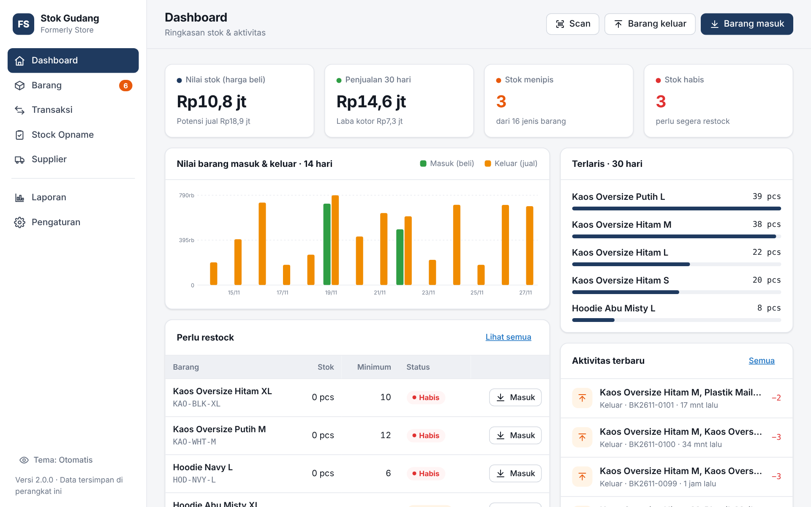

# 📦 Stok Gudang Pro — Demo

Aplikasi pencatat stok barang & gudang untuk **seller online, toko, dan distributor**. Jalan offline, sekali bayar, tanpa langganan.

**▶ Coba demo:** https://labib404.github.io/stok-gudang/

## Fitur
- Dashboard: nilai stok, penjualan & laba 30 hari, barang perlu restock, barang terlaris
- Barang masuk / keluar / transfer antar gudang / penyesuaian + cetak surat jalan
- Multi-gudang, supplier, kartu stok per barang, harga modal rata-rata otomatis
- Stock opname dengan scan barcode, selisih otomatis disesuaikan
- Cetak label barcode & scan pakai kamera HP / scanner USB
- Laporan nilai stok, pergerakan stok, penjualan & laba, barang lambat laku → export Excel
- Import barang dari Excel, backup & restore, bisa di-install di HP, mode gelap

## Versi demo
Versi demo dibatasi maksimal 25 barang, dan fitur export, cetak, import & backup dikunci.
Versi lengkap (file aplikasi + panduan PDF + template Excel) tersedia dengan sekali bayar.

© 2026 Muhammad Labib Al'Bukhori. Hak cipta dilindungi. Dilarang menyalin, mendistribusikan, atau menjual ulang tanpa izin.
